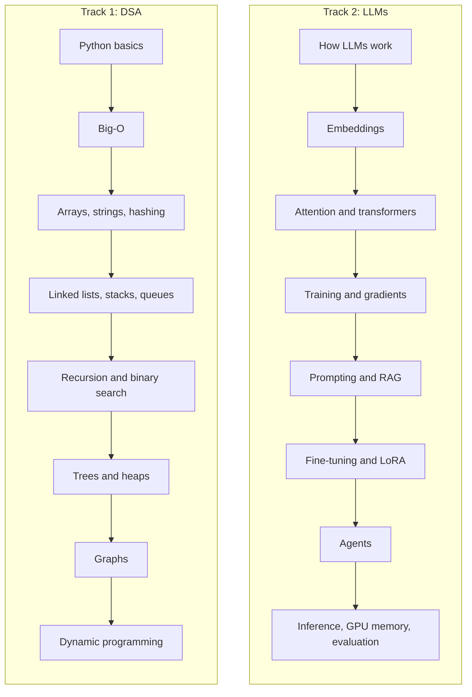

# DSA and LLMs, Made Simple

A friendly, visual guide for students learning **Data Structures and Algorithms (DSA)** and **Large Language Models (LLMs)**.

Every topic is explained the same way: a one-sentence summary, a real-life picture of the idea, a diagram, short Python code, and questions to check yourself. No heavy math to start, and no jargon without an explanation.

## Who this is for

- Students preparing for coding interviews
- Anyone who wants to finally understand how ChatGPT-style models actually work
- Self-learners who prefer pictures and examples over long textbooks

## Learning roadmap

The two tracks are independent: you can study DSA and LLMs in parallel.

## Part 1: Data Structures and Algorithms

| # | Topic | You'll learn |
|---|---|---|
| 1 | [Big-O](dsa/01-big-o.md) | How to measure if code is fast or slow |
| 2 | [Arrays and strings](dsa/02-arrays-and-strings.md) | Two pointers and sliding window |
| 3 | [Hashing](dsa/03-hashing.md) | Instant lookups with dictionaries and sets |
| 4 | [Linked lists](dsa/04-linked-lists.md) | Nodes, pointers and the fast/slow trick |
| 5 | [Stacks and queues](dsa/05-stacks-and-queues.md) | Last in first out, first in first out |
| 6 | [Recursion and backtracking](dsa/06-recursion-and-backtracking.md) | Solving problems by solving smaller ones |
| 7 | [Binary search](dsa/07-binary-search.md) | Finding things fast in sorted data |
| 8 | [Trees](dsa/08-trees.md) | Traversals and binary search trees |
| 9 | [Heaps](dsa/09-heaps.md) | Always knowing the smallest or largest item |
| 10 | [Graphs](dsa/10-graphs.md) | BFS, DFS and shortest paths |
| 11 | [Dynamic programming](dsa/11-dynamic-programming.md) | Remembering answers so you never repeat work |
| ★ | [Patterns cheat sheet](dsa/patterns-cheatsheet.md) | Which technique to use when |

## Part 2: Large Language Models

| # | Topic | You'll learn |
|---|---|---|
| 1 | [How LLMs work](llm/01-how-llms-work.md) | Tokens and next-word prediction |
| 2 | [Embeddings](llm/02-embeddings.md) | Turning meaning into numbers |
| 3 | [Attention and transformers](llm/03-attention-and-transformers.md) | How models understand context |
| 4 | [Training and gradients](llm/04-training-and-gradients.md) | How models learn, step by step |
| 5 | [Prompting](llm/05-prompting.md) | Getting better answers without training |
| 6 | [RAG](llm/06-rag.md) | Giving a model knowledge it doesn't have |
| 7 | [Fine-tuning and LoRA](llm/07-fine-tuning-and-lora.md) | Changing how a model behaves |
| 8 | [Agents](llm/08-agents.md) | Models that use tools and take actions |
| 9 | [Inference and GPU memory](llm/09-inference-and-gpu-memory.md) | Why models need so much memory, and how to save it |
| 10 | [Hallucination and evaluation](llm/10-hallucination-and-evaluation.md) | When models are wrong, and how to measure it |

## How to use this guide

1. **Read one topic at a time.** Each page takes about 20 to 40 minutes.
2. **Type the code yourself** instead of copying it. You'll remember it much better.
3. **Answer the "Check yourself" questions** out loud, without looking.
4. **Do the practice problems** in order, from easy to hard.
5. **Come back after a week** and re-read only the summaries. Spaced repetition is what makes it stick.

## Extra resources

The best free books, courses, videos and practice sites, chosen for beginners: [resources.md](resources.md)

## Contributing

Found a mistake, or want to add a topic? Contributions are welcome. See [CONTRIBUTING.md](CONTRIBUTING.md).

## Author

**Anjali Parihar**, data and AI engineer
[LinkedIn](https://www.linkedin.com/in/anjali-parihar-) · [Portfolio](https://anjaliparihar97.github.io) · [GPU memory experiments](https://github.com/anjaliparihar97/llm-gpu-memory)

If this guide helps you, give it a star so other students can find it.

## License

[MIT](LICENSE)
