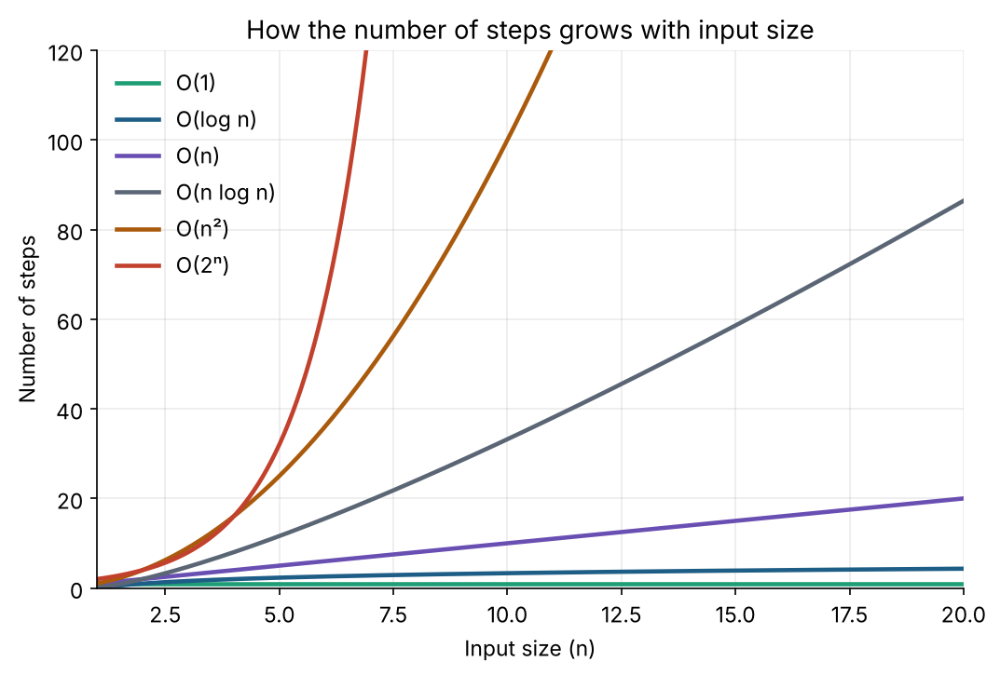

# 1. Big-O: is my code fast or slow?

**In one sentence:** Big-O describes how the number of steps your code takes grows as the input gets bigger.

## Picture it

You're looking for a friend's name in a list of 1,000 people.
- Reading the names one by one might take **1,000 checks**. That's O(n).
- If the list is sorted alphabetically, you can open it in the middle and throw away half each time. That takes about **10 checks**. That's O(log n).
- If you already know the exact page, it takes **1 check**. That's O(1).

Big-O doesn't measure seconds. It measures how the work **grows**.



## The common complexities

| Big-O | Name | Example | 1,000 items |
|---|---|---|---|
| O(1) | Constant | Get `arr[5]`, look up a key in a dict | 1 step |
| O(log n) | Logarithmic | Binary search | ~10 steps |
| O(n) | Linear | Loop through a list once | 1,000 steps |
| O(n log n) | Linearithmic | Good sorting (merge sort, Python's `sort`) | ~10,000 steps |
| O(n²) | Quadratic | Two nested loops over the same list | 1,000,000 steps |
| O(2ⁿ) | Exponential | Trying every subset | more than atoms in the universe |

## How to find the Big-O of code

```python
def total(nums):              # O(n): one loop
    s = 0
    for x in nums:
        s += x
    return s

def has_duplicate_slow(nums): # O(n²): loop inside a loop
    for i in range(len(nums)):
        for j in range(i + 1, len(nums)):
            if nums[i] == nums[j]:
                return True
    return False

def has_duplicate_fast(nums): # O(n): one loop + O(1) set lookups
    seen = set()
    for x in nums:
        if x in seen:
            return True
        seen.add(x)
    return False
```

**Rules of thumb:**
- Loops one after another: **add** them, then keep the biggest. O(n) + O(n) = O(n).
- Loops inside loops: **multiply** them. O(n) × O(n) = O(n²).
- Drop constants: O(2n) is just O(n).
- Halving the input each step means O(log n).

## Space complexity

Big-O also describes **memory**. `has_duplicate_fast` uses an extra set that can grow to n items, so its space complexity is O(n). It trades memory for speed, which is one of the most common trade-offs in programming.

## Check yourself

1. What is the Big-O of a loop that runs from 1 to n, doubling `i` each time (`i *= 2`)?
2. Why is `has_duplicate_fast` faster than `has_duplicate_slow`, and what does it cost?
3. Is O(n log n) closer to O(n) or to O(n²) for large n?

<details>
<summary>Answers</summary>

1. O(log n), because `i` doubles, so it reaches n after about log₂(n) steps.
2. It checks each number against a set in O(1) instead of looping again. It costs O(n) extra memory.
3. Much closer to O(n). For n = 1,000,000, log n is only about 20.
</details>

**Next:** [Arrays and strings](02-arrays-and-strings.md)
