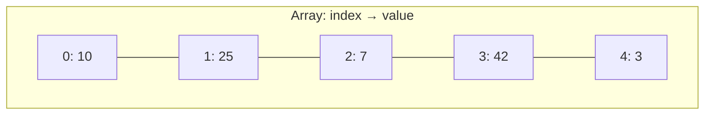
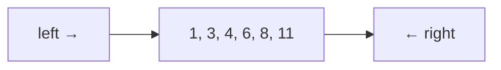

# 2. Arrays and strings

**In one sentence:** An array stores items side by side in memory, so you can jump to any position instantly by its index.

## Picture it

A row of numbered lockers. To open locker 7, you walk straight to it; you don't check lockers 1 to 6 first. But inserting a new locker in the middle means shifting every locker after it.



| Operation | Big-O |
|---|---|
| Read or change `arr[i]` | O(1) |
| Add or remove at the end | O(1) on average |
| Insert or remove in the middle | O(n), everything after shifts |
| Search for a value (unsorted) | O(n) |

Strings behave like arrays of characters. In Python, strings can't be changed in place, so building a string piece by piece is best done with a list and `"".join(...)`.

## Pattern 1: Two pointers

Use two positions that move toward each other or in the same direction. Great for sorted arrays and comparing ends.



**Example: does a sorted list contain two numbers that add up to a target?**

```python
def two_sum_sorted(nums, target):
    left, right = 0, len(nums) - 1
    while left < right:
        s = nums[left] + nums[right]
        if s == target:
            return [left, right]
        if s < target:
            left += 1      # need a bigger sum
        else:
            right -= 1     # need a smaller sum
    return []
```
Time O(n), space O(1), instead of O(n²) for checking every pair.

## Pattern 2: Sliding window

Keep a "window" over part of the array and slide it, instead of recalculating from scratch.

**Example: largest sum of any 3 consecutive numbers.**

```python
def max_window_sum(nums, k):
    window = sum(nums[:k])
    best = window
    for i in range(k, len(nums)):
        window += nums[i] - nums[i - k]   # add the new item, remove the old one
        best = max(best, window)
    return best
```

## Pattern 3: Prefix sums

Precompute running totals, so any range sum takes O(1).

```python
nums = [3, 1, 4, 1, 5]
prefix = [0]
for x in nums:
    prefix.append(prefix[-1] + x)      # [0, 3, 4, 8, 9, 14]
# sum of nums[1..3] = prefix[4] - prefix[1] = 9 - 3 = 6
```

## Practice

| Problem | Pattern | Level |
|---|---|---|
| [Best Time to Buy and Sell Stock](https://leetcode.com/problems/best-time-to-buy-and-sell-stock/) | One pass | Easy |
| [Product of Array Except Self](https://leetcode.com/problems/product-of-array-except-self/) | Prefix and suffix | Medium |
| [Container With Most Water](https://leetcode.com/problems/container-with-most-water/) | Two pointers | Medium |
| [3Sum](https://leetcode.com/problems/3sum/) | Sort + two pointers | Medium |
| [Longest Substring Without Repeating Characters](https://leetcode.com/problems/longest-substring-without-repeating-characters/) | Sliding window | Medium |

## Check yourself

1. Why is inserting at the start of an array O(n)?
2. When does two pointers work best?
3. What does a sliding window save you?

<details>
<summary>Answers</summary>

1. Every existing item has to shift one position to the right.
2. On sorted data, or when comparing items from both ends.
3. Recalculating the whole window each time: you update it in O(1) per step.
</details>

**Next:** [Hashing](03-hashing.md)
