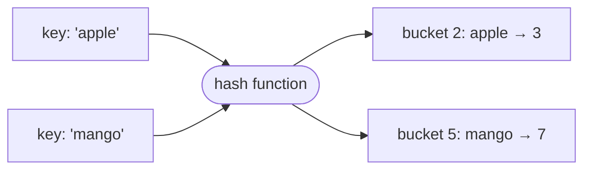

# 3. Hashing: dictionaries and sets

**In one sentence:** A hash table turns a key into a position using a hash function, so you can store and find items in O(1) on average.

## Picture it

A coat check. You hand over your coat and get ticket number 47. Later, you don't search every coat; you go straight to hook 47. The hash function is the system that turns your coat (the key) into a hook number.



In Python, `dict` and `set` are hash tables.

| Operation | Average | Worst case |
|---|---|---|
| Insert, look up, delete | O(1) | O(n), when many keys collide |

A **collision** happens when two keys land in the same bucket. Good hash functions keep collisions rare, which is why the average stays O(1).

## The most useful trick: "have I seen this before?"

**Example: Two Sum (unsorted).** Find two numbers that add up to a target.

```python
def two_sum(nums, target):
    seen = {}                       # value -> index
    for i, x in enumerate(nums):
        need = target - x
        if need in seen:            # O(1) lookup
            return [seen[need], i]
        seen[x] = i
    return []
```

**Example: count things.**

```python
from collections import Counter
Counter("banana")   # Counter({'a': 3, 'n': 2, 'b': 1})
```

**Example: group things by a key.**

```python
from collections import defaultdict
def group_anagrams(words):
    groups = defaultdict(list)
    for w in words:
        groups["".join(sorted(w))].append(w)   # 'eat', 'tea', 'ate' -> 'aet'
    return list(groups.values())
```

## When to think "hashing"

- "Have I seen this before?" → set
- "How many times?" → Counter
- "Find a pair that adds up to..." → dict of what you need
- "Group items that are similar" → dict of lists

## Practice

| Problem | Idea | Level |
|---|---|---|
| [Contains Duplicate](https://leetcode.com/problems/contains-duplicate/) | Set | Easy |
| [Valid Anagram](https://leetcode.com/problems/valid-anagram/) | Counter | Easy |
| [Two Sum](https://leetcode.com/problems/two-sum/) | Dict of complements | Easy |
| [Group Anagrams](https://leetcode.com/problems/group-anagrams/) | Dict of lists | Medium |
| [Top K Frequent Elements](https://leetcode.com/problems/top-k-frequent-elements/) | Counter + heap or buckets | Medium |

## Check yourself

1. Why is looking up a key in a dict O(1) on average but O(n) in the worst case?
2. How does the Two Sum solution avoid a nested loop?
3. Can a list be a dictionary key in Python? Why or why not?

<details>
<summary>Answers</summary>

1. Normally the key goes straight to its bucket. If many keys collide in one bucket, you may have to check them one by one.
2. For each number, it checks in O(1) whether the needed partner was already seen.
3. No. Keys must be hashable, and lists can change, so their hash could change. Use a tuple instead.
</details>

**Next:** [Linked lists](04-linked-lists.md)
