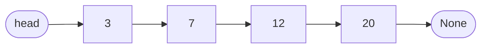
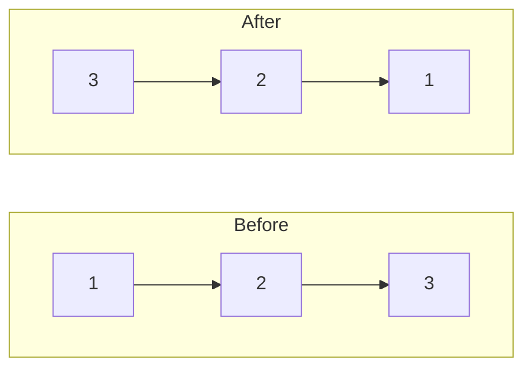

# 4. Linked lists

**In one sentence:** A linked list is a chain of nodes, where each node holds a value and a pointer to the next node.

## Picture it

A treasure hunt. Each clue tells you where the next clue is. You can't jump to clue 5 directly; you have to follow the chain. But adding a new clue in the middle is easy: just change where one clue points.



| Operation | Array | Linked list |
|---|---|---|
| Access the i-th item | O(1) | O(n) |
| Insert or delete at the front | O(n) | O(1) |
| Insert or delete after a known node | O(n) | O(1) |

```python
class Node:
    def __init__(self, val, next=None):
        self.val = val
        self.next = next
```

## Classic 1: Reverse a linked list

Turn every arrow around, one node at a time.

```python
def reverse(head):
    prev = None
    curr = head
    while curr:
        nxt = curr.next     # remember the rest of the list
        curr.next = prev    # turn the arrow around
        prev = curr
        curr = nxt
    return prev             # the new head
```



## Classic 2: Fast and slow pointers

Two pointers move through the list at different speeds. The slow one moves 1 step, the fast one 2 steps.
- **Find the middle:** when fast reaches the end, slow is in the middle.
- **Detect a cycle:** if there's a loop, fast eventually catches up with slow, like a faster runner lapping a slower one on a track.

```python
def has_cycle(head):
    slow = fast = head
    while fast and fast.next:
        slow = slow.next
        fast = fast.next.next
        if slow is fast:
            return True
    return False
```

**Tip:** a "dummy" node in front of the head makes many problems simpler, because you never have to treat the first node as a special case.

## Practice

| Problem | Idea | Level |
|---|---|---|
| [Reverse Linked List](https://leetcode.com/problems/reverse-linked-list/) | Turn arrows around | Easy |
| [Merge Two Sorted Lists](https://leetcode.com/problems/merge-two-sorted-lists/) | Dummy node | Easy |
| [Linked List Cycle](https://leetcode.com/problems/linked-list-cycle/) | Fast and slow | Easy |

## Check yourself

1. Why is getting the 100th item slower in a linked list than in an array?
2. In the reverse function, why do we save `curr.next` before changing it?
3. Why must the fast pointer catch the slow one if there's a cycle?

<details>
<summary>Answers</summary>

1. You have to follow 100 pointers; there's no direct jump by index.
2. Changing `curr.next` would lose the rest of the list.
3. Inside the loop, the gap between them shrinks by one each step, so it must reach zero.
</details>

**Next:** [Stacks and queues](05-stacks-and-queues.md)
