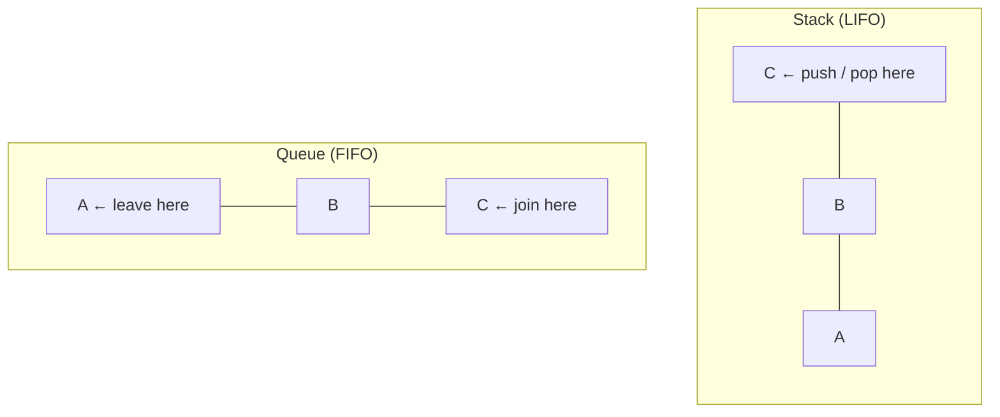

# 5. Stacks and queues

**In one sentence:** A stack gives you the most recently added item first (last in, first out); a queue gives you the oldest item first (first in, first out).

## Picture it

- **Stack:** a pile of plates. You put plates on top and take them from the top. Your browser's back button is a stack.
- **Queue:** a line at a coffee shop. The first person in line is served first. A printer's job list is a queue.



```python
stack = []
stack.append("A"); stack.append("B")
stack.pop()                 # 'B', O(1)

from collections import deque
queue = deque()
queue.append("A"); queue.append("B")
queue.popleft()             # 'A', O(1). Don't use list.pop(0), it's O(n)
```

## Classic: valid parentheses

Every closing bracket must match the most recent unmatched opening bracket. "Most recent" means stack.

```python
def is_valid(s):
    pairs = {")": "(", "]": "[", "}": "{"}
    stack = []
    for ch in s:
        if ch in pairs:
            if not stack or stack.pop() != pairs[ch]:
                return False
        else:
            stack.append(ch)
    return not stack
```

## Monotonic stack: "next greater element"

Keep the stack in decreasing order. When a bigger number arrives, it's the answer for everything smaller waiting on the stack.

```python
def daily_temperatures(temps):
    answer = [0] * len(temps)
    stack = []                          # indexes of days still waiting for a warmer day
    for i, t in enumerate(temps):
        while stack and temps[stack[-1]] < t:
            j = stack.pop()
            answer[j] = i - j
        stack.append(i)
    return answer
```

Queues appear again in [graphs](10-graphs.md): breadth-first search is built on a queue.

## Practice

| Problem | Idea | Level |
|---|---|---|
| [Valid Parentheses](https://leetcode.com/problems/valid-parentheses/) | Stack | Easy |
| [Min Stack](https://leetcode.com/problems/min-stack/) | Stack of (value, current min) | Medium |
| [Daily Temperatures](https://leetcode.com/problems/daily-temperatures/) | Monotonic stack | Medium |

## Check yourself

1. Which structure would you use for an "undo" button, and why?
2. Why is `deque.popleft()` better than `list.pop(0)`?
3. In daily temperatures, why does each index get pushed and popped at most once?

<details>
<summary>Answers</summary>

1. A stack, because undo reverses the most recent action first.
2. `popleft` is O(1); `pop(0)` shifts every remaining item, which is O(n).
3. Once a day finds its warmer day, it leaves the stack forever, so the total work is O(n).
</details>

**Next:** [Recursion and backtracking](06-recursion-and-backtracking.md)
