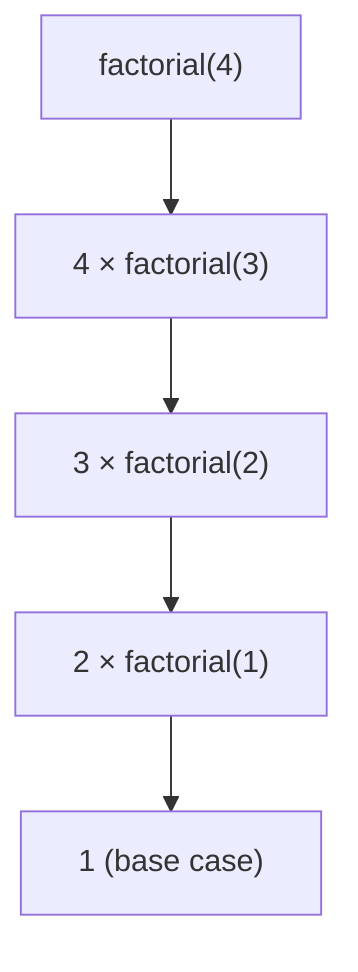
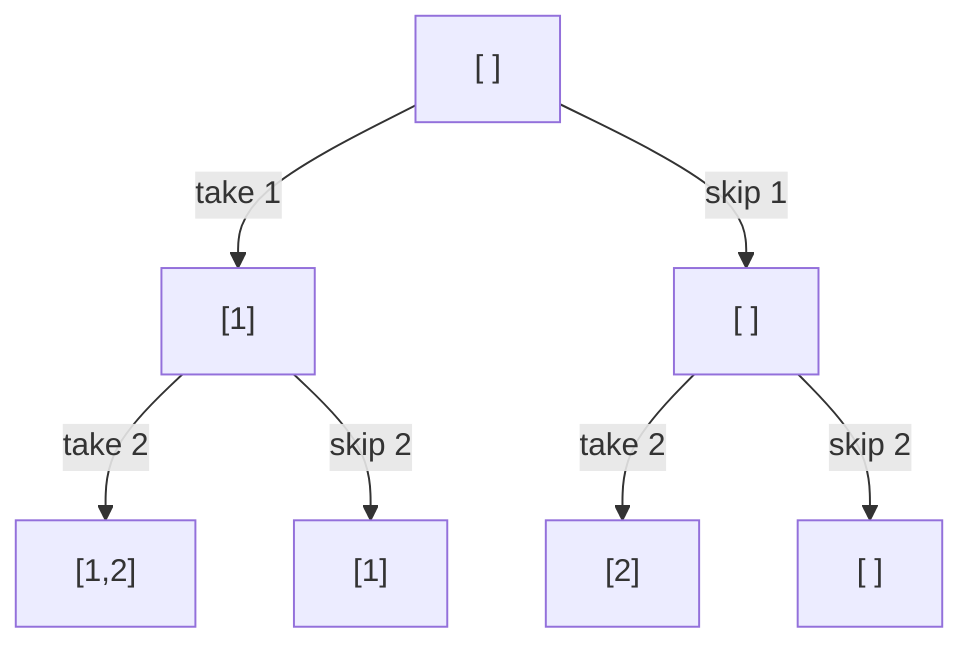

# 6. Recursion and backtracking

**In one sentence:** A recursive function solves a problem by calling itself on a smaller version of the same problem, until it reaches a case simple enough to answer directly.

## Picture it

Russian nesting dolls. To find the smallest doll, open the doll, and repeat with the doll inside, until there's nothing left to open. "Nothing left to open" is the **base case**.

Every recursive function needs:
1. **A base case:** when to stop.
2. **A recursive case:** how to make the problem smaller.

```python
def factorial(n):
    if n <= 1:          # base case
        return 1
    return n * factorial(n - 1)   # smaller problem
```



Each call waits on the **call stack** until the smaller call returns. Too many nested calls cause a "maximum recursion depth" error.

## Backtracking: try, explore, undo

Backtracking builds a solution step by step, and **undoes** the last choice when it hits a dead end. It's like exploring a maze: walk forward, and when you hit a wall, step back to the last junction and try another path.

**Example: all subsets of [1, 2, 3].**

```python
def subsets(nums):
    result, path = [], []
    def explore(i):
        if i == len(nums):
            result.append(path[:])      # save a copy
            return
        path.append(nums[i])            # choose: include nums[i]
        explore(i + 1)
        path.pop()                      # undo the choice
        explore(i + 1)                  # choose: skip nums[i]
    explore(0)
    return result
```



Each level makes one yes/no choice, so n items give 2ⁿ subsets. That's why backtracking is often exponential, and why we try to **prune** paths that can't succeed.

## Practice

| Problem | Idea | Level |
|---|---|---|
| [Subsets](https://leetcode.com/problems/subsets/) | Include or skip | Medium |
| [Permutations](https://leetcode.com/problems/permutations/) | Choose an unused item | Medium |
| [Combination Sum](https://leetcode.com/problems/combination-sum/) | Backtracking with pruning | Medium |
| [Word Search](https://leetcode.com/problems/word-search/) | Backtracking on a grid | Medium |

## Check yourself

1. What happens if a recursive function has no base case?
2. Why does `subsets` save `path[:]` instead of `path`?
3. Why do we call `path.pop()` after exploring?

<details>
<summary>Answers</summary>

1. It calls itself forever until Python raises a recursion error.
2. `path` keeps changing; `path[:]` saves a snapshot copy.
3. To undo the choice, so the next branch starts from the right state.
</details>

**Next:** [Binary search](07-binary-search.md)
