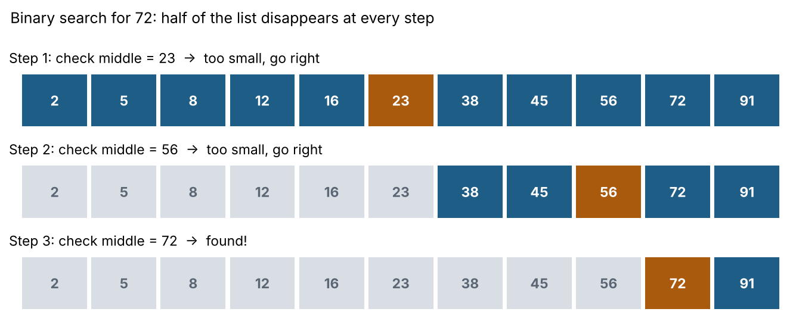
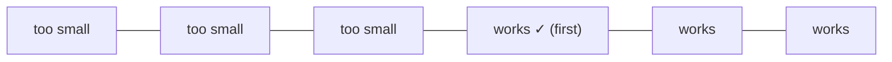

# 7. Binary search

**In one sentence:** Binary search finds an item in sorted data by checking the middle and throwing away the half that can't contain it, so it needs only O(log n) steps.

## Picture it

The number-guessing game. "I'm thinking of a number between 1 and 100." Guess 50. "Higher." Guess 75. "Lower." Guess 62. Each guess cuts the possibilities in half, so you need at most 7 guesses for 100 numbers, and only about 20 for a million.



```python
def binary_search(nums, target):
    lo, hi = 0, len(nums) - 1
    while lo <= hi:
        mid = (lo + hi) // 2
        if nums[mid] == target:
            return mid
        if nums[mid] < target:
            lo = mid + 1       # target is in the right half
        else:
            hi = mid - 1       # target is in the left half
    return -1                  # not found
```

## The bigger idea: search on the answer

Binary search works on anything where the answer is "no, no, no, yes, yes, yes." If you can check "is this value good enough?", you can binary search for the smallest value that works.



**Example:** "What's the minimum speed to finish all tasks in H hours?" Try a middle speed: if it's fast enough, try slower; if not, try faster.

## Common mistakes

- Using `while lo < hi` vs. `lo <= hi` without thinking about which you need. Test with a list of one item.
- Forgetting `+ 1` / `- 1`, which causes an infinite loop.
- Using it on **unsorted** data. Binary search only works when the order lets you throw away half.

Python also has a built-in module: `import bisect`, with `bisect_left(nums, x)` returning where `x` would be inserted.

## Practice

| Problem | Idea | Level |
|---|---|---|
| [Binary Search](https://leetcode.com/problems/binary-search/) | Classic | Easy |
| [Search in Rotated Sorted Array](https://leetcode.com/problems/search-in-rotated-sorted-array/) | Find the sorted half | Medium |

## Check yourself

1. How many steps does binary search need for 1,000,000 items, roughly?
2. Why must the data be sorted?
3. What does "search on the answer" mean?

<details>
<summary>Answers</summary>

1. About 20, because 2²⁰ is about a million.
2. Sorting is what tells you which half the target can't be in.
3. Binary searching over possible answers, using a yes/no check, instead of over array positions.
</details>

**Next:** [Trees](08-trees.md)
