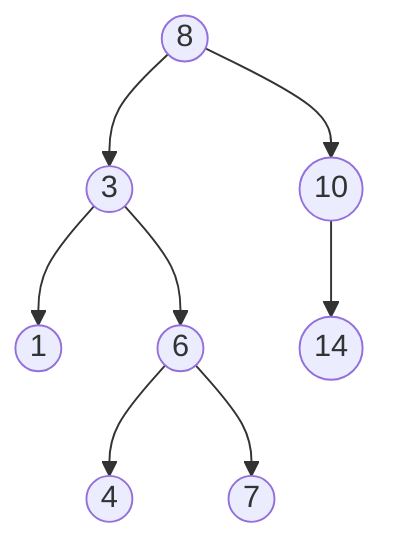

# 8. Trees

**In one sentence:** A tree is a structure of nodes where each node has children, starting from one root, with no loops.

## Picture it

A family tree, or the folders on your computer: one top folder, folders inside folders, and files at the ends (the **leaves**).

A **binary tree** has at most two children per node: left and right.



```python
class TreeNode:
    def __init__(self, val, left=None, right=None):
        self.val, self.left, self.right = val, left, right
```

## Traversals: the order you visit nodes

| Traversal | Order | For the tree above |
|---|---|---|
| Preorder | node, left, right | 8, 3, 1, 6, 4, 7, 10, 14 |
| Inorder | left, node, right | 1, 3, 4, 6, 7, 8, 10, 14 |
| Postorder | left, right, node | 1, 4, 7, 6, 3, 14, 10, 8 |
| Level order (BFS) | level by level | 8, 3, 10, 1, 6, 14, 4, 7 |

Most tree problems are short recursive functions:

```python
def max_depth(root):
    if not root:
        return 0
    return 1 + max(max_depth(root.left), max_depth(root.right))
```

## Binary search tree (BST)

In a BST, every node's left side is smaller and right side is bigger. The tree above is a BST, which is why its **inorder** traversal comes out sorted.

| Operation | Balanced BST | Unbalanced (worst case) |
|---|---|---|
| Search, insert, delete | O(log n) | O(n) |

An unbalanced tree can become a long chain, like a linked list. Self-balancing trees (like red-black trees) prevent that.

```python
def search_bst(root, target):
    while root and root.val != target:
        root = root.left if target < root.val else root.right
    return root
```

## Practice

| Problem | Idea | Level |
|---|---|---|
| [Maximum Depth of Binary Tree](https://leetcode.com/problems/maximum-depth-of-binary-tree/) | Recursion | Easy |
| [Invert Binary Tree](https://leetcode.com/problems/invert-binary-tree/) | Swap children | Easy |
| [Binary Tree Level Order Traversal](https://leetcode.com/problems/binary-tree-level-order-traversal/) | BFS with a queue | Medium |
| [Validate Binary Search Tree](https://leetcode.com/problems/validate-binary-search-tree/) | Pass min and max limits | Medium |
| [Lowest Common Ancestor of a BST](https://leetcode.com/problems/lowest-common-ancestor-of-a-binary-search-tree/) | Use BST ordering | Medium |

## Check yourself

1. Why does an inorder traversal of a BST give sorted values?
2. When does a BST become as slow as a linked list?
3. What's the base case in most recursive tree functions?

<details>
<summary>Answers</summary>

1. It visits everything smaller (left) before the node, and everything bigger (right) after it.
2. When items are inserted in sorted order without balancing, so each node has only one child.
3. An empty node (`None`).
</details>

**Next:** [Heaps](09-heaps.md)
