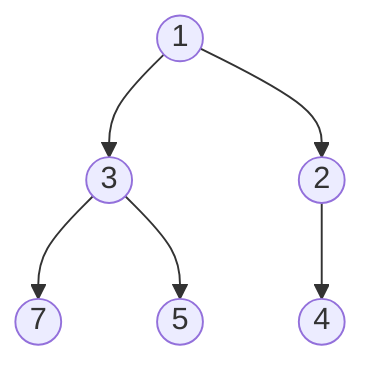

# 9. Heaps and priority queues

**In one sentence:** A heap always keeps the smallest (or largest) item at the top, so you can get it in O(1) and add or remove items in O(log n).

## Picture it

A hospital emergency room. Patients aren't treated in arrival order but by urgency: the most urgent patient is always next. New patients slot in by how urgent they are. That's a **priority queue**, and a heap is how it's built.



In a **min-heap**, every parent is smaller than its children, so the smallest item is always at the root. It's stored efficiently in a plain list: `[1, 3, 2, 7, 5, 4]`.

| Operation | Big-O |
|---|---|
| Look at the smallest item | O(1) |
| Add an item (`heappush`) | O(log n) |
| Remove the smallest (`heappop`) | O(log n) |
| Build a heap from a list (`heapify`) | O(n) |

```python
import heapq
nums = [5, 1, 8, 3]
heapq.heapify(nums)          # nums is now a min-heap
heapq.heappush(nums, 2)
smallest = heapq.heappop(nums)   # 1
```

Python only has a min-heap. For a max-heap, push negative numbers: `heappush(h, -x)`.

## Classic: the k largest items

Keep a min-heap of size k. Whenever it grows past k, remove the smallest. What's left are the k largest.

```python
def k_largest(nums, k):
    heap = []
    for x in nums:
        heapq.heappush(heap, x)
        if len(heap) > k:
            heapq.heappop(heap)
    return heap              # the k largest; heap[0] is the k-th largest
```
Time O(n log k), much better than sorting everything when k is small.

## Where heaps appear

- "Top k" or "k-th largest" problems
- Merging many sorted lists
- Dijkstra's shortest path algorithm (see [graphs](10-graphs.md))
- Scheduling tasks by priority

## Practice

| Problem | Idea | Level |
|---|---|---|
| [Kth Largest Element in an Array](https://leetcode.com/problems/kth-largest-element-in-an-array/) | Min-heap of size k | Medium |
| [Top K Frequent Elements](https://leetcode.com/problems/top-k-frequent-elements/) | Counter + heap | Medium |
| [Find Median from Data Stream](https://leetcode.com/problems/find-median-from-data-stream/) | Two heaps | Hard |

## Check yourself

1. Why is getting the smallest item O(1) but removing it O(log n)?
2. How do you make a max-heap in Python?
3. Why use a heap of size k instead of sorting for "top k"?

<details>
<summary>Answers</summary>

1. It's always at the root, but after removing it, the heap has to reorganize along one path from top to bottom, which has about log n levels.
2. Store negative values and negate them again when you pop.
3. Sorting is O(n log n); a size-k heap is O(n log k), which is faster when k is much smaller than n.
</details>

**Next:** [Graphs](10-graphs.md)
