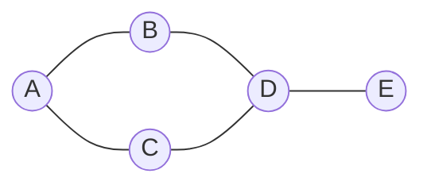

# 10. Graphs

**In one sentence:** A graph is a set of nodes connected by edges, used to model anything with connections: maps, friendships, networks, task dependencies.

## Picture it

A city map: places are **nodes**, roads are **edges**. A one-way street is a **directed** edge. A road with a length is a **weighted** edge.



The most common way to store a graph is an **adjacency list**:

```python
graph = {
    "A": ["B", "C"],
    "B": ["A", "D"],
    "C": ["A", "D"],
    "D": ["B", "C", "E"],
    "E": ["D"],
}
```

## BFS and DFS: two ways to explore

| | Breadth-first search (BFS) | Depth-first search (DFS) |
|---|---|---|
| How it explores | Level by level, like ripples in water | As deep as possible, then backtracks, like a maze |
| Built on | A queue | A stack or recursion |
| Best for | Shortest path when all edges count the same | Exploring everything, detecting cycles, connected regions |

```python
from collections import deque

def bfs(graph, start):
    visited = {start}
    queue = deque([start])
    order = []
    while queue:
        node = queue.popleft()
        order.append(node)
        for nb in graph[node]:
            if nb not in visited:
                visited.add(nb)
                queue.append(nb)
    return order            # A, B, C, D, E

def dfs(graph, node, visited=None):
    if visited is None:
        visited = set()
    visited.add(node)
    for nb in graph[node]:
        if nb not in visited:
            dfs(graph, nb, visited)
    return visited
```

Both are O(V + E): every node (V) and every edge (E) is handled once. The `visited` set is essential; without it, you'd loop forever in a graph with cycles.

## Grids are graphs too

Many problems give you a 2D grid. Each cell is a node, and its neighbors are up, down, left and right.

```python
def num_islands(grid):
    rows, cols = len(grid), len(grid[0])
    def sink(r, c):
        if r < 0 or c < 0 or r >= rows or c >= cols or grid[r][c] != "1":
            return
        grid[r][c] = "0"                       # mark as visited
        for dr, dc in [(1, 0), (-1, 0), (0, 1), (0, -1)]:
            sink(r + dr, c + dc)
    count = 0
    for r in range(rows):
        for c in range(cols):
            if grid[r][c] == "1":
                count += 1
                sink(r, c)
    return count
```

## Shortest paths with weights: Dijkstra

When edges have different lengths, BFS isn't enough. **Dijkstra's algorithm** always expands the closest unvisited node next, using a [heap](09-heaps.md). It works when all weights are zero or positive.

```python
import heapq
def dijkstra(graph, start):          # graph: node -> [(neighbor, weight)]
    dist = {start: 0}
    heap = [(0, start)]
    while heap:
        d, node = heapq.heappop(heap)
        if d > dist[node]:
            continue                 # an outdated entry
        for nb, w in graph[node]:
            nd = d + w
            if nd < dist.get(nb, float("inf")):
                dist[nb] = nd
                heapq.heappush(heap, (nd, nb))
    return dist
```

## Topological sort: doing tasks in the right order

For dependencies like "take Math 1 before Math 2," a topological sort orders tasks so every task comes after the ones it depends on. If there's a cycle, no valid order exists.

## Practice

| Problem | Idea | Level |
|---|---|---|
| [Number of Islands](https://leetcode.com/problems/number-of-islands/) | DFS on a grid | Medium |
| [Clone Graph](https://leetcode.com/problems/clone-graph/) | BFS or DFS with a map | Medium |
| [Course Schedule](https://leetcode.com/problems/course-schedule/) | Cycle detection / topological sort | Medium |
| [Network Delay Time](https://leetcode.com/problems/network-delay-time/) | Dijkstra | Medium |

## Check yourself

1. Why does BFS find the shortest path in an unweighted graph?
2. What goes wrong without a `visited` set?
3. Why can't you use plain BFS when edges have different weights?

<details>
<summary>Answers</summary>

1. It explores all nodes at distance 1, then distance 2, and so on, so the first time it reaches a node is by the fewest edges.
2. In a graph with cycles, you'd revisit nodes forever.
3. Fewer edges doesn't mean shorter distance when edges have different lengths.
</details>

**Next:** [Dynamic programming](11-dynamic-programming.md)
