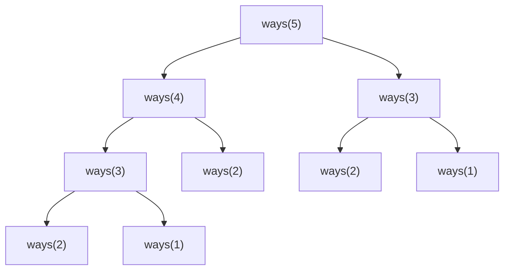

# 11. Dynamic programming

**In one sentence:** Dynamic programming (DP) solves a problem by breaking it into overlapping smaller problems, and remembering each answer so it's never calculated twice.

## Picture it

Someone asks you "what's 1 + 1 + 1 + 1 + 1?" You count: 5. Then they add "+ 1" and ask again. You don't recount from the start; you remember 5 and say 6. That's dynamic programming: **remember, don't repeat.**

## Why plain recursion can be slow

Counting the ways to climb n stairs, taking 1 or 2 steps at a time: the ways to reach step n = ways to reach n−1 + ways to reach n−2.



`ways(3)` and `ways(2)` are calculated again and again. Plain recursion takes O(2ⁿ) time.

## Two ways to fix it

**Top-down (memoization):** recursion plus a memory of answers.

```python
from functools import cache

@cache
def ways(n):
    if n <= 2:
        return n
    return ways(n - 1) + ways(n - 2)
```

**Bottom-up (tabulation):** fill a table from the smallest case upward.

```python
def ways(n):
    if n <= 2:
        return n
    prev, curr = 1, 2               # ways(1), ways(2)
    for _ in range(3, n + 1):
        prev, curr = curr, prev + curr
    return curr
```
Both run in O(n) instead of O(2ⁿ).

## A recipe for any DP problem

1. **Define the state:** what does `dp[i]` mean, in words? For example: "the most money I can rob from the first i houses."
2. **Find the recurrence:** how does `dp[i]` depend on smaller states? "Either rob house i plus `dp[i-2]`, or skip it and take `dp[i-1]`."
3. **Set the base cases:** the smallest answers you know directly.
4. **Choose the order:** solve smaller states before the ones that need them.

```python
def rob(houses):
    prev, curr = 0, 0                  # best up to i-2, best up to i-1
    for money in houses:
        prev, curr = curr, max(curr, prev + money)
    return curr
```

## Signs a problem needs DP

- It asks for the **number of ways**, the **minimum**, or the **maximum**.
- Choices at each step affect future choices.
- A brute-force recursion repeats the same subproblems.

## Practice

| Problem | Idea | Level |
|---|---|---|
| [Climbing Stairs](https://leetcode.com/problems/climbing-stairs/) | dp[n] = dp[n-1] + dp[n-2] | Easy |
| [House Robber](https://leetcode.com/problems/house-robber/) | Rob or skip | Medium |
| [Coin Change](https://leetcode.com/problems/coin-change/) | Fewest coins for each amount | Medium |
| [Longest Increasing Subsequence](https://leetcode.com/problems/longest-increasing-subsequence/) | Best ending at each index | Medium |
| [Longest Common Subsequence](https://leetcode.com/problems/longest-common-subsequence/) | 2D table | Medium |
| [Edit Distance](https://leetcode.com/problems/edit-distance/) | 2D table | Medium |

## Check yourself

1. What's the difference between memoization and tabulation?
2. Why is plain recursive climbing stairs O(2ⁿ)?
3. What's the first thing to write down when solving a DP problem?

<details>
<summary>Answers</summary>

1. Memoization starts from the big problem and caches recursive answers; tabulation fills a table from the smallest case upward.
2. Each call makes two more calls, and the same subproblems are recomputed many times.
3. The meaning of the state, `dp[i]`, in plain words.
</details>

**Next:** [Patterns cheat sheet](patterns-cheatsheet.md)
