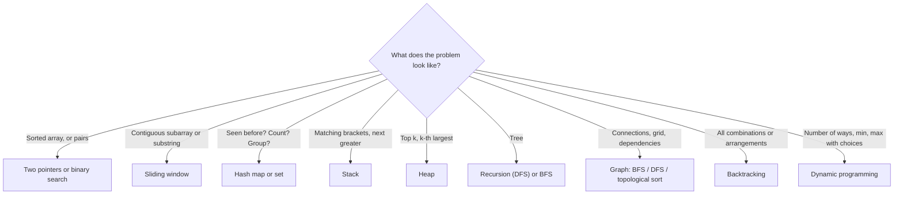

# Patterns cheat sheet

When you read a new problem, look for these clues.

| Clue in the problem | Try | Typical Big-O |
|---|---|---|
| Sorted array, find a pair or target | Two pointers, binary search | O(n), O(log n) |
| Longest or shortest subarray/substring with a condition | Sliding window | O(n) |
| "Have I seen this?", counts, grouping | Hash map or set | O(n) |
| Range sums asked many times | Prefix sums | O(1) per query |
| Matching pairs, undo, next greater element | Stack, monotonic stack | O(n) |
| Top k, k-th largest, merge sorted lists | Heap | O(n log k) |
| Linked list middle, cycle | Fast and slow pointers | O(n) |
| Tree depth, paths, validation | DFS recursion | O(n) |
| Shortest path, unweighted | BFS | O(V + E) |
| Shortest path, weighted (no negatives) | Dijkstra | O(E log V) |
| Task order with dependencies | Topological sort | O(V + E) |
| All subsets, permutations, combinations | Backtracking | Exponential |
| Count ways, min cost, max value with choices | Dynamic programming | Usually O(n) or O(n²) |

## Interview approach in 5 steps

1. **Clarify:** repeat the problem in your own words, ask about edge cases (empty input, duplicates, negatives).
2. **Start simple:** describe the brute-force solution and its Big-O.
3. **Improve:** look for a pattern from this sheet to do better.
4. **Code:** write clean code, saying what you're doing as you go.
5. **Test:** walk through a small example and an edge case by hand.

**Back to:** [Main page](../README.md)
