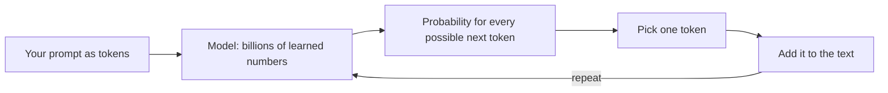

# 1. How LLMs work

**In one sentence:** A large language model (LLM) is a program that has read enormous amounts of text and learned to predict the next piece of text, one piece at a time.

## Picture it

Your phone's keyboard suggests the next word as you type. An LLM is the same idea, scaled up enormously: trained on a huge amount of text, with billions of adjustable numbers, so its predictions become good enough to write essays, answer questions and write code.

## Step 1: Text becomes tokens

Models don't read letters or whole words; they read **tokens**, which are common pieces of words.

```
"Learning is unbelievable fun"
→ ["Learning", " is", " un", "believ", "able", " fun"]
→ [42293, 374, 653, 32927, 481, 2523]      (illustrative split and IDs)
```

Each token gets an ID number. A rough rule for English: 1 token ≈ ¾ of a word. Token counts matter because models have a limit on how many tokens they can handle at once (the **context window**), and API usage is usually priced per token.

## Step 2: Predict the next token, again and again



For "The cat sat on the", the model might give:

| Next token | Probability |
|---|---|
| mat | 62% |
| floor | 20% |
| sofa | 8% |
| ... | ... |

It picks one, adds it to the text, and repeats. A long answer is just hundreds of these steps in a row.

**Temperature** controls how the token is picked. Low temperature means it almost always picks the most likely token (focused, repeatable). Higher temperature gives less likely tokens more of a chance (more varied and creative, but also more mistakes).

## Step 3: From text predictor to assistant

1. **Pretraining:** the model reads a huge amount of text and learns to predict the next token. It learns language, facts and patterns.
2. **Fine-tuning on examples:** it's trained on example conversations, so it learns to answer helpfully instead of just continuing text.
3. **Learning from feedback:** people (or other models) rate answers, and the model is adjusted toward better ones. This is often called RLHF (reinforcement learning from human feedback).

## Key terms

| Term | Meaning |
|---|---|
| Token | A piece of text the model reads and writes |
| Parameters | The learned numbers inside the model (billions of them) |
| Context window | How many tokens the model can consider at once |
| Inference | Using a trained model to generate output |
| Temperature | How random the token choice is |

## Check yourself

1. Why does an LLM generate text one token at a time?
2. What happens if the temperature is very high?
3. What's the difference between pretraining and fine-tuning?

<details>
<summary>Answers</summary>

1. It's trained to predict the next token, so it builds text by repeating that prediction.
2. Unlikely tokens get picked more often, so text becomes more varied but less reliable.
3. Pretraining teaches general language from huge amounts of text; fine-tuning adjusts the model for a specific behavior, like being a helpful assistant.
</details>

**Next:** [Embeddings](02-embeddings.md)
