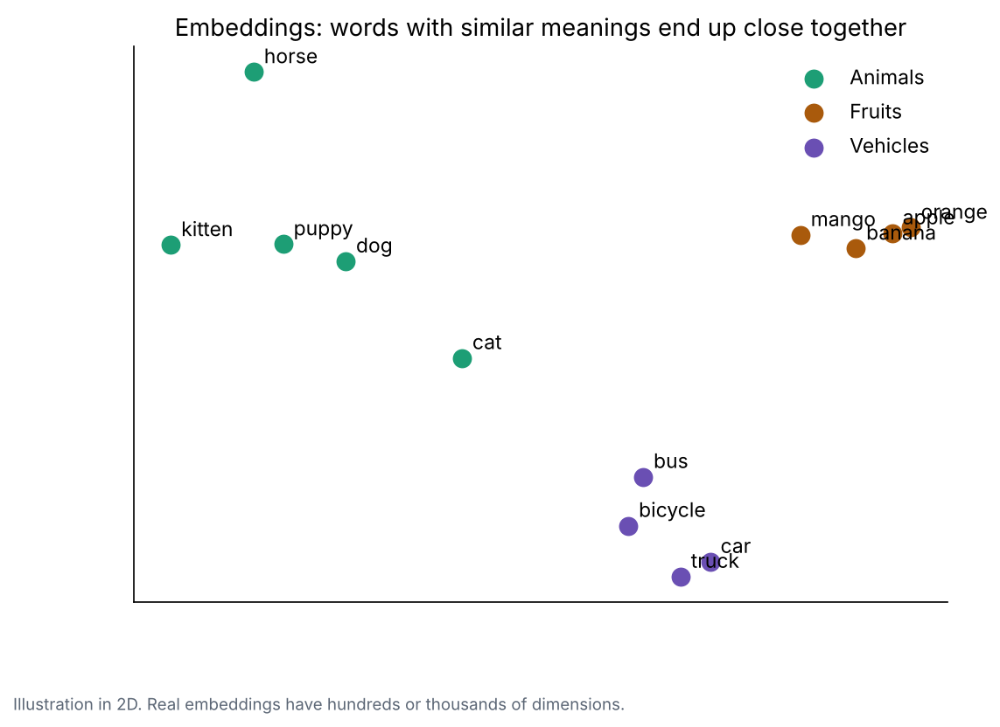
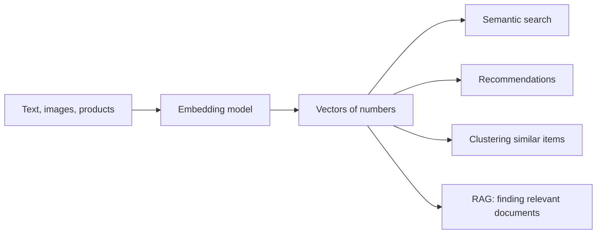

# 2. Embeddings: meaning as numbers

**In one sentence:** An embedding is a list of numbers that represents the meaning of a word, sentence or image, so that similar meanings get similar numbers.

## Picture it

Imagine describing animals with just two numbers: size and how wild they are. A kitten might be (1, 2), a lion (8, 9), a house cat (2, 2). Animals that are alike end up close together. Embeddings do the same, but with hundreds or thousands of numbers that the model learns on its own.



Similar meanings land close together even with no shared words: "the stock market crashed" and "shares fell sharply" get similar embeddings.

## Measuring similarity: cosine similarity

Think of each embedding as an arrow. If two arrows point in the same direction, the meanings are similar.

| Cosine similarity | Meaning |
|---|---|
| Close to 1 | Very similar meaning |
| Close to 0 | Unrelated |
| Negative | Opposite directions |

```python
import numpy as np

def cosine_similarity(a, b):
    return np.dot(a, b) / (np.linalg.norm(a) * np.linalg.norm(b))

cat   = np.array([0.9, 0.8, 0.1])     # toy 3-number embeddings
kitten = np.array([0.85, 0.75, 0.2])
truck = np.array([0.1, 0.2, 0.95])

print(cosine_similarity(cat, kitten))   # high, about 0.996
print(cosine_similarity(cat, truck))    # low, about 0.29
```

## What embeddings are used for



- **Semantic search:** find documents by meaning, not exact keywords.
- **Recommendations:** suggest items similar to what someone liked.
- **RAG:** find the most relevant text to give an LLM (see [RAG](06-rag.md)).

A **vector database** stores embeddings and finds the closest ones quickly, even among millions, using approximate nearest neighbor search.

## Check yourself

1. Why do "car" and "automobile" get similar embeddings?
2. What does a cosine similarity close to 1 mean?
3. Why does semantic search find results that keyword search misses?

<details>
<summary>Answers</summary>

1. The model learned they appear in similar contexts and mean the same thing.
2. The two embeddings point in almost the same direction: very similar meaning.
3. It compares meanings, so it matches results with different words but the same idea.
</details>

**Next:** [Attention and transformers](03-attention-and-transformers.md)
