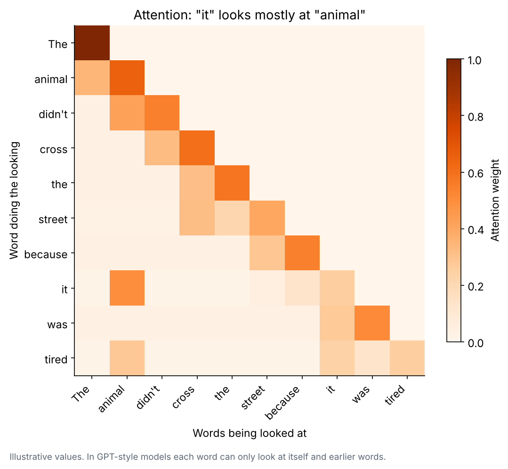
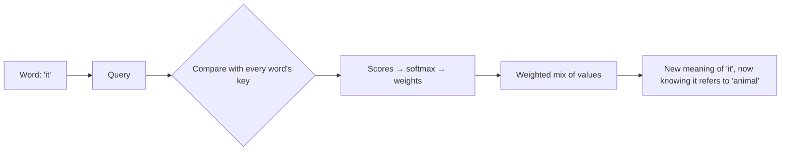
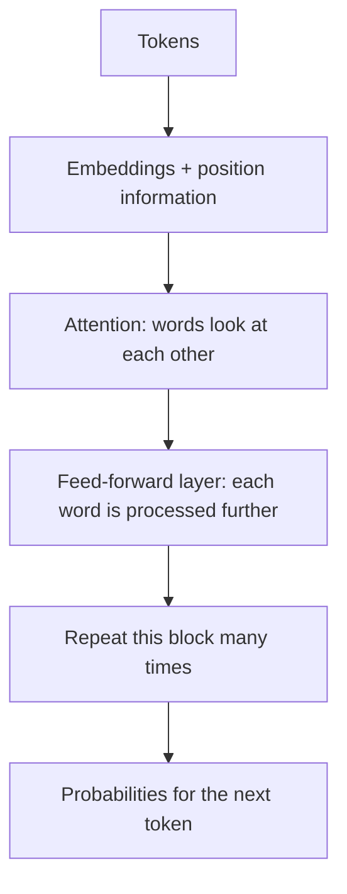

# 3. Attention and transformers

**In one sentence:** A transformer is the model design behind modern LLMs, and its key idea, attention, lets every word look at the other words to understand its meaning in context.

## Picture it

Read this: "The animal didn't cross the street because **it** was tired." You instantly know "it" means the animal. If the sentence ended with "because it was too wide," you'd know "it" means the street. Your brain looks at the other words to decide. Attention gives a model the same ability.



## How attention works, simply

For every word, the model creates three things:
- **Query:** "what am I looking for?"
- **Key:** "what do I contain?"
- **Value:** "what information do I pass on?"

Each word compares its query with every other word's key. Good matches get high attention weights, and the word collects a weighted mix of their values.



```python
import numpy as np

def attention(Q, K, V):
    scores = Q @ K.T / np.sqrt(K.shape[1])          # how well each query matches each key
    weights = np.exp(scores) / np.exp(scores).sum(axis=1, keepdims=True)  # softmax
    return weights @ V                               # weighted mix of values
```

## Why transformers changed everything

Older models (RNNs) read text one word at a time and tended to forget the beginning of long texts. Transformers process all words **at the same time**, which:
- captures relationships between words far apart, and
- runs efficiently on GPUs, which are built for parallel work. That's what made it possible to train huge models.

## Inside a transformer



Models stack dozens of these blocks. **Multi-head attention** runs several attention calculations in parallel, so different heads can focus on different relationships (grammar, meaning, references). GPT-style models use **causal** attention: each word can only look at earlier words, because the model generates text left to right.

The original transformer was introduced in the 2017 paper ["Attention Is All You Need"](https://arxiv.org/abs/1706.03762).

## Check yourself

1. What problem does attention solve?
2. Why are transformers faster to train than older models like RNNs?
3. What are the query, key and value, in simple words?

<details>
<summary>Answers</summary>

1. Understanding each word in the context of the others, even far apart.
2. They process all words in parallel, which suits GPUs.
3. Query: what a word is looking for. Key: what a word offers for matching. Value: the information it passes on.
</details>

**Next:** [Training and gradients](04-training-and-gradients.md)
