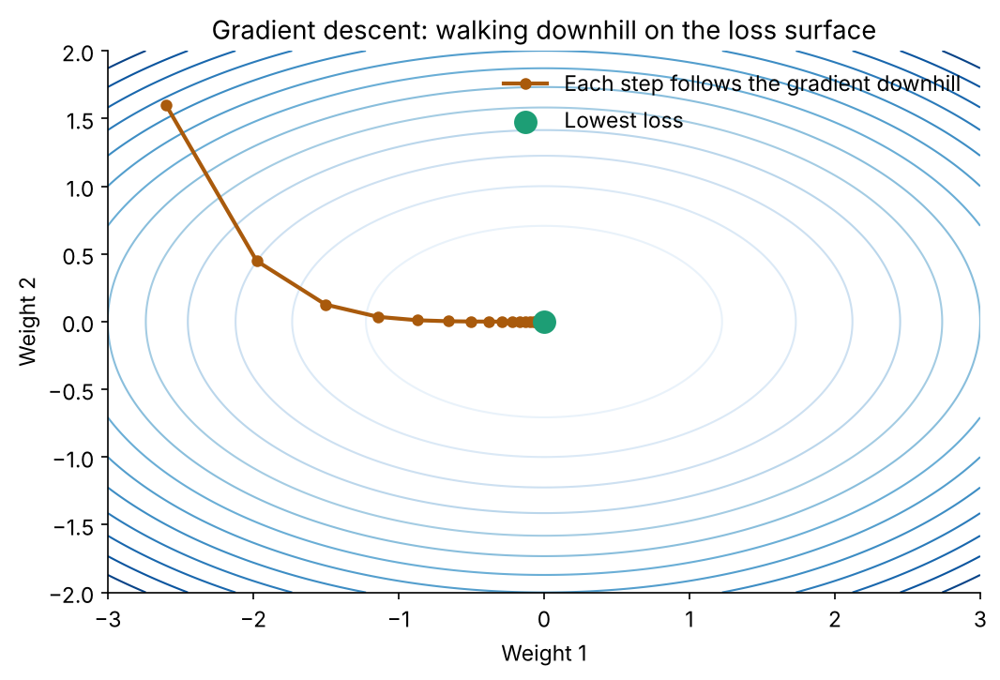
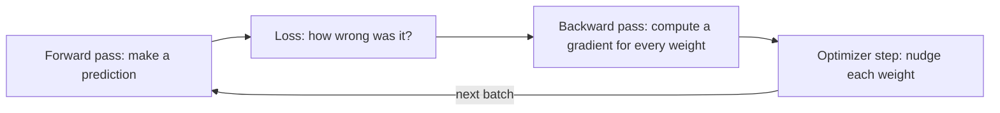
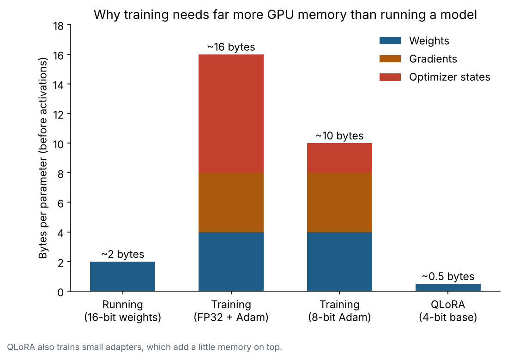

# 4. Training and gradients

**In one sentence:** Training means showing the model examples, measuring how wrong its predictions are, and nudging its numbers a little in the direction that makes it less wrong, millions of times.

## Picture it

You're blindfolded on a hilly field and want to reach the lowest point. You feel the ground with your foot: which way slopes down, and how steeply? You take a small step that way, then feel again. The slope you feel is the **gradient**, the height is the **loss** (how wrong the model is), and each step is one training update.



## The training loop



1. **Forward pass:** the model predicts the next token for a batch of text.
2. **Loss:** compare the prediction with the real next token. A big loss means very wrong.
3. **Backward pass (backpropagation):** calculate, for every weight, how much it contributed to the error. That's its gradient.
4. **Optimizer step:** move each weight a little against its gradient. The **learning rate** controls how big the step is.

## Gradients in ten lines

One weight `w` learns that `w × 2` should equal 6, so the right answer is `w = 3`:

```python
import torch

x, y = torch.tensor(2.0), torch.tensor(6.0)
w = torch.tensor(0.5, requires_grad=True)
lr = 0.05

for step in range(8):
    loss = (w * x - y) ** 2       # forward pass + loss
    loss.backward()               # backward pass: computes w.grad
    with torch.no_grad():
        w -= lr * w.grad          # optimizer step
    w.grad = None
    print(f"step {step}: w = {w.item():.3f}, loss = {loss.item():.3f}")
```

`w` moves toward 3 and the loss shrinks. As `w` gets close, the gradient gets smaller, so the steps automatically get smaller too. A real LLM does exactly this, for billions of weights at once.

## Learning rate: not too big, not too small

| Learning rate | What happens |
|---|---|
| Too small | Learning is painfully slow |
| Just right | Loss decreases steadily |
| Too big | Steps overshoot the bottom; loss jumps around or explodes |

## Why training needs so much memory

Every weight needs its own gradient, and the popular **Adam** optimizer keeps two extra running averages per weight. On top of that come **activations**: intermediate results saved during the forward pass for the backward pass.



More on this, with real measurements, in [Inference and GPU memory](09-inference-and-gpu-memory.md).

## Overfitting

If a model memorizes its training examples instead of learning general patterns, it does great on training data but poorly on new data. That's **overfitting**. We detect it by testing on data the model never saw during training.

## Check yourself

1. What does the gradient tell the optimizer?
2. What happens if the learning rate is too high?
3. Why does training use much more memory than using a model?

<details>
<summary>Answers</summary>

1. For each weight, which direction reduces the loss and how strongly.
2. Updates overshoot, so the loss bounces around or grows instead of decreasing.
3. Training also stores a gradient for every weight, optimizer states, and activations for the backward pass.
</details>

**Next:** [Prompting](05-prompting.md)
