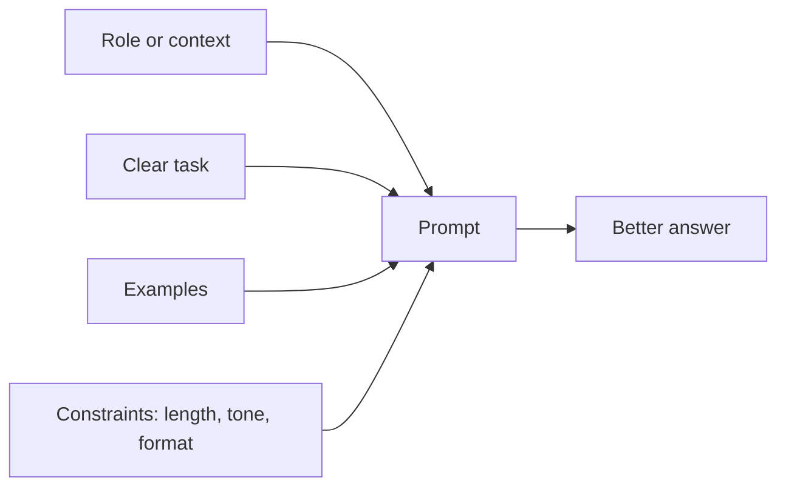

# 5. Prompting

**In one sentence:** Prompting is how you instruct a model, and better instructions usually give better answers, without any training.

## Picture it

Asking a new colleague for help. "Write something about our product" gets you something vague. "Write a 3-sentence product description for busy parents, friendly tone, mentioning the 10-minute setup" gets you what you need. Models work the same way.

## What a good prompt contains



| Element | Example |
|---|---|
| Context | "You're helping a student prepare for a data analyst interview." |
| Task | "Explain what a LEFT JOIN does." |
| Examples | "Here's an example of the style I like: ..." |
| Constraints | "Use one short paragraph and one SQL example." |
| Format | "Return the answer as JSON with fields `term` and `definition`." |

## Useful techniques

**Few-shot prompting:** show a few examples of the input and output you want.

```
Classify the sentiment as positive or negative.

Review: "Arrived quickly and works perfectly." → positive
Review: "Broke after two days." → negative
Review: "Great value, would buy again." →
```

**Ask for step-by-step reasoning:** for math or logic problems, asking the model to work through the problem step by step often improves accuracy.

**Give it permission to say "I don't know":** "If the answer isn't in the text, say you don't know." This reduces made-up answers.

**Specify the output format:** tables, bullet points or JSON make answers easier to use in programs.

## Before you fine-tune, prompt

Prompting is the cheapest step on the ladder: it costs nothing to change and often works surprisingly well. Only move to [RAG](06-rag.md) or [fine-tuning](07-fine-tuning-and-lora.md) when a well-written prompt with examples isn't enough.

## Check yourself

1. What's few-shot prompting?
2. Why does telling the model it can say "I don't know" help?
3. When should you consider something beyond prompting?

<details>
<summary>Answers</summary>

1. Including a few examples of inputs and desired outputs in the prompt.
2. Without it, the model may produce a confident guess instead of admitting it lacks the information.
3. When the model lacks knowledge (use RAG) or keeps behaving wrongly despite good prompts (consider fine-tuning).
</details>

**Next:** [RAG](06-rag.md)
