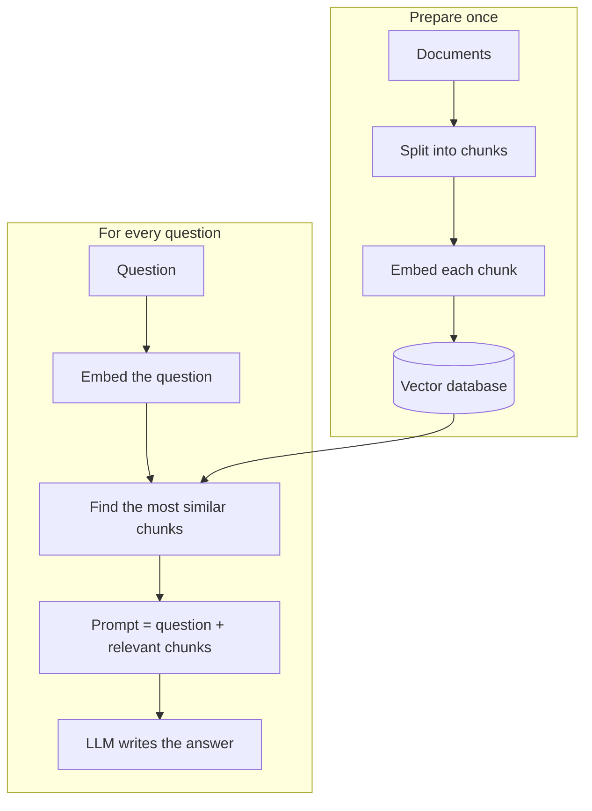

# 6. RAG: retrieval-augmented generation

**In one sentence:** RAG lets a model answer using documents it was never trained on, by first finding the relevant text and then giving it to the model together with the question.

## Picture it

An open-book exam. The model is a smart student, but it hasn't read your company's documents or today's news. RAG lets it look up the right pages before answering, instead of guessing.

## How RAG works



1. **Chunk:** split documents into small pieces, often a few hundred tokens each, with some overlap.
2. **Embed:** turn each chunk into an [embedding](02-embeddings.md).
3. **Store:** save the embeddings in a vector database.
4. **Retrieve:** embed the question the same way and find the most similar chunks, usually with cosine similarity.
5. **Generate:** give the question and the chunks to the LLM, with an instruction to answer only from them.

**Important:** use the same embedding model for documents and questions. Different models create different "maps" of meaning, so their vectors can't be compared.

## A tiny RAG retrieval example

```python
import numpy as np

def top_k_chunks(question_vec, chunk_vecs, chunks, k=3):
    sims = chunk_vecs @ question_vec / (
        np.linalg.norm(chunk_vecs, axis=1) * np.linalg.norm(question_vec))
    best = np.argsort(sims)[::-1][:k]
    return [chunks[i] for i in best]

prompt = """Answer the question using only the context below.
If the answer isn't in the context, say you don't know.

Context:
{context}

Question: {question}"""
```

## RAG or fine-tuning?

**Use RAG to give a model knowledge. Use fine-tuning to change how it behaves.**

| | RAG | Fine-tuning |
|---|---|---|
| Best for | Facts, documents, information that changes | Style, format, narrow skills |
| Updating knowledge | Update the documents | Train again |
| Shows sources | Yes | No |

## Ways to improve RAG

- **Chunk size:** too big mixes topics, too small loses context.
- **Hybrid search:** combine meaning-based search with keyword search, which helps with names and exact terms.
- **Re-ranking:** re-score the top results with a more precise model.
- **Evaluation:** test retrieval (did we find the right chunks?) and answers (are they correct?) separately.

## Check yourself

1. Why does RAG reduce made-up answers?
2. Why must documents and questions use the same embedding model?
3. When is RAG better than fine-tuning?

<details>
<summary>Answers</summary>

1. The model answers from real, retrieved text instead of only from memory.
2. Different models produce embeddings in different spaces, so similarity scores between them are meaningless.
3. When the model needs knowledge, especially private or frequently changing information.
</details>

**Next:** [Fine-tuning and LoRA](07-fine-tuning-and-lora.md)
