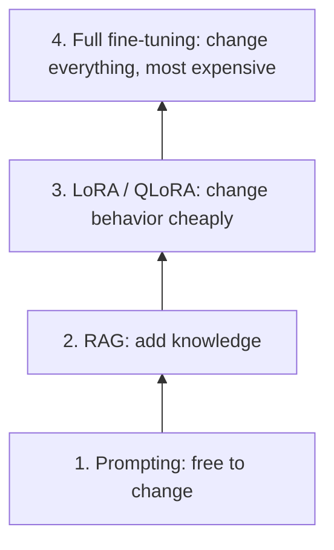
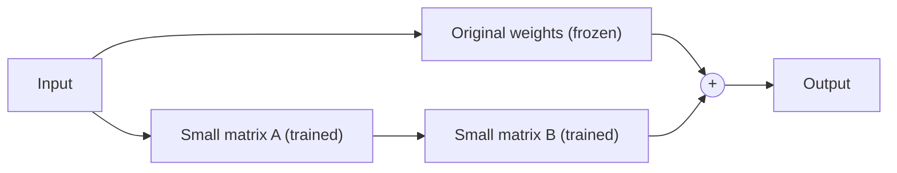

# 7. Fine-tuning and LoRA

**In one sentence:** Fine-tuning continues training a pretrained model on your own examples to change how it behaves; LoRA does this cheaply by training only small add-on pieces.

## Picture it

A pretrained model is like a well-educated new employee. Fine-tuning is job training: they already know the language, and now they learn your company's style and procedures. LoRA is like giving them a small notebook of company-specific notes instead of rewriting everything they know.

## The customization ladder

Each step costs more time, money and maintenance. Only climb when the step below isn't enough.



## Full fine-tuning vs. LoRA

**Full fine-tuning** updates all of the model's weights. For a model with billions of parameters, that needs huge amounts of GPU memory (see [training memory](04-training-and-gradients.md)).

**LoRA (Low-Rank Adaptation)** freezes the original model and adds small trainable matrices to some layers. Often well under 1% of the parameters are trained.



**QLoRA** goes further: it loads the frozen model in a compressed 4-bit format and trains LoRA adapters on top, which makes fine-tuning possible on a single GPU.

Benefits of LoRA:
- Much less memory and compute
- Small adapter files (megabytes instead of gigabytes)
- Several adapters can share one base model, one per task

## When fine-tuning makes sense

| Good reasons | Poor reasons |
|---|---|
| A consistent tone or style | Teaching facts that change often (use RAG) |
| A strict output format | Problems a better prompt would solve |
| A narrow, high-volume task | Very little training data |
| Domain language a general model keeps getting wrong | |

## Data quality matters most

During training, the model learns your examples as closely as possible, including their mistakes. A few hundred clean, consistent examples often beat thousands of messy ones.

```python
# Setting up LoRA with Hugging Face PEFT (sketch)
from peft import LoraConfig, get_peft_model

config = LoraConfig(r=16, lora_alpha=32, lora_dropout=0.05,
                    target_modules=["q_proj", "v_proj"], task_type="CAUSAL_LM")
model = get_peft_model(base_model, config)
model.print_trainable_parameters()     # shows how few parameters are trained
```

## Check yourself

1. What's the main difference between full fine-tuning and LoRA?
2. What does QLoRA add on top of LoRA?
3. Should you fine-tune to teach a model this month's prices? Why or why not?

<details>
<summary>Answers</summary>

1. Full fine-tuning updates every weight; LoRA freezes the model and trains small add-on matrices.
2. It loads the frozen base model in 4-bit precision, saving even more memory.
3. No. Prices change, so the model would quickly be out of date. RAG keeps facts easy to update.
</details>

**Next:** [Agents](08-agents.md)
