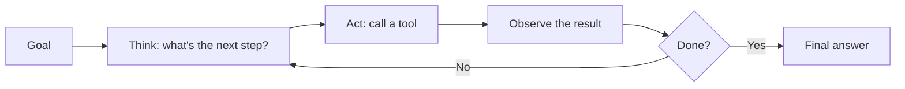

# 8. Agents

**In one sentence:** An AI agent is an LLM that can use tools, like search, code or email, and works in a loop of thinking, acting and checking results until a task is done.

## Picture it

A chatbot is like asking a knowledgeable friend a question: they can only talk. An agent is like a personal assistant: you give them a goal, and they look things up, make calls, fill in forms and report back when it's done.

## The agent loop



**Example goal:** "Find new data analyst jobs in Hamburg and email me the best three."

1. **Think:** I need current job listings. → **Act:** call a job search tool. → **Observe:** 40 results.
2. **Think:** filter by the user's skills. → **Act:** compare each job with the resume. → **Observe:** 5 good matches.
3. **Think:** pick the best three and email them. → **Act:** call the email tool. → **Done.**

## How tools work

The model is given a list of tools with descriptions, for example: "`search_jobs(city, keywords)`: returns current job listings." When it decides a tool would help, it outputs a structured request, your program runs the tool, and the result goes back to the model.

```python
tools = {
    "search_jobs": lambda city, keywords: [...],   # your real function
    "send_email":  lambda to, body: "sent",
}
# The model replies with something like:
# {"tool": "search_jobs", "args": {"city": "Hamburg", "keywords": "data analyst"}}
# Your code runs tools["search_jobs"](**args) and returns the result to the model.
```

## What makes agents hard

- **Reliability over many steps:** small mistakes add up in long tasks.
- **Error recovery:** tools fail, websites change, results are unexpected.
- **Safety:** an agent that can send emails or spend money needs limits.
- **Prompt injection:** text from websites or emails can contain hidden instructions trying to trick the agent.

## Human in the loop

A simple, safe design is a traffic light for actions:

| Level | Examples | Rule |
|---|---|---|
| Green | Searching, reading, summarizing | The agent acts on its own |
| Yellow | Drafting an email, saving a note | The agent acts, a human can review |
| Red | Sending money, deleting data, applying for a job | A human must approve first |

## Check yourself

1. What's the difference between a chatbot and an agent?
2. Who actually runs a tool: the model or your program?
3. Why should some actions require human approval?

<details>
<summary>Answers</summary>

1. A chatbot only produces text; an agent can use tools and take actions in a loop.
2. Your program. The model only requests a tool call with arguments.
3. Some actions can't be undone or have real consequences, and agents can make mistakes or be tricked.
</details>

**Next:** [Inference and GPU memory](09-inference-and-gpu-memory.md)
