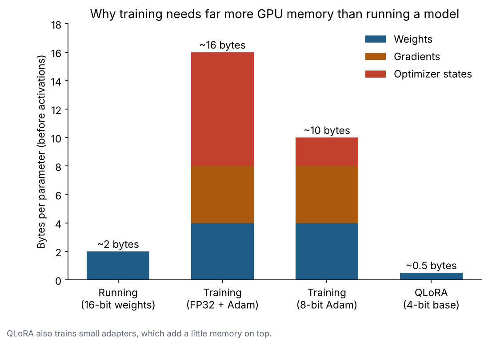
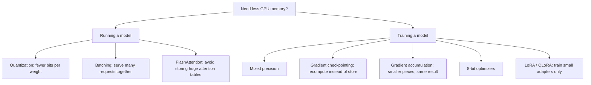

# 9. Inference and GPU memory

**In one sentence:** Running and training models is limited mostly by GPU memory, and techniques like quantization, batching and LoRA are about using that memory well.

## Picture it

GPU memory is like a desk. Everything the model needs must fit on the desk at the same time; if it doesn't fit, you get the famous "CUDA out of memory" error. Saving memory means fitting more on the same desk.

## Running a model: what's on the desk

| Part | What it is | Grows with |
|---|---|---|
| Weights | The model's learned numbers | Model size and precision |
| KV cache | The model's memory of tokens it already processed | Prompt length and number of users |
| Working memory | Temporary results during calculation | Prompt length, batch size |

**Weight memory ≈ number of parameters × bytes per number:**

| Precision | Bytes per number | 7B-parameter model |
|---|---|---|
| 32-bit | 4 | ~28 GB |
| 16-bit | 2 | ~14 GB |
| 8-bit | 1 | ~7 GB |
| 4-bit | 0.5 | ~3.5 GB |

## Training a model: a much more crowded desk

Training also stores a gradient for every weight, Adam's two optimizer values per weight, and activations from the forward pass.

## Techniques for saving memory

## What real measurements show

From experiments on a free NVIDIA T4 GPU ([llm-gpu-memory](https://github.com/anjaliparihar97/llm-gpu-memory)):

- **4-bit quantization cut weight memory by 60%**, but generation was about **5× slower** than 16-bit on that GPU. Smaller doesn't automatically mean faster.
- **Batching 16 prompts** gave about **7.6× more throughput** for only 8% more memory.
- **A 7,500-token prompt** needed over 6 GB of memory on top of the model weights.
- **In training**, the weights were only about 20% of peak memory. Gradients, optimizer states and activations made up the rest.

## Check yourself

1. Roughly how much memory do the weights of a 7B model need in 16-bit?
2. Why can quantization make a model slower?
3. Which training technique trades extra computation for less memory?

Answers

1. About 14 GB (7 billion × 2 bytes).
2. Compressed weights have to be converted back during calculations, which adds work.
3. Gradient checkpointing: it recomputes activations instead of storing them all.

**Next:** [Hallucination and evaluation](10-hallucination-and-evaluation.md)
