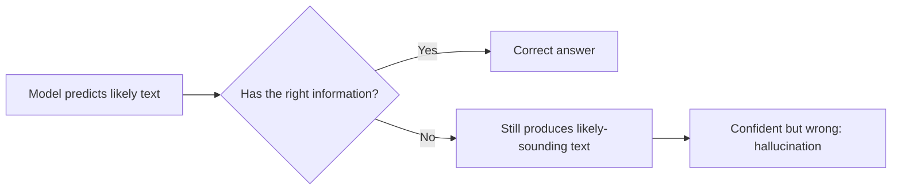

# 10. Hallucination and evaluation

**In one sentence:** LLMs sometimes produce fluent, confident answers that are wrong (hallucinations), so we need ways to reduce them and to measure how well a system really works.

## Picture it

A student who doesn't know the answer in an exam, but writes something that sounds convincing anyway. LLMs are trained to produce likely-sounding text, not to check facts, so when they don't know, they can still sound sure.

## Why hallucinations happen



Common causes:
- The answer isn't in the training data, or the data is outdated.
- The question is ambiguous.
- The model is given wrong or messy information (bad data in, bad answers out).

## How to reduce them

| Technique | How it helps |
|---|---|
| [RAG](06-rag.md) | Answers come from real documents |
| Allow "I don't know" | Removes pressure to guess |
| Ask for sources | Makes answers checkable |
| Lower temperature | Less random output for factual tasks |
| Human review | Essential for important decisions |
| Clean data | The model can only be as reliable as its information |

## How to evaluate an LLM system

1. **Build a test set:** real questions with known correct answers.
2. **Decide what "good" means:** correct, complete, grounded in sources, right format, safe.
3. **Measure regularly:** especially after changing the prompt, model or data. Treat it like regression testing in software.
4. **Evaluate parts separately:** in RAG, check retrieval (were the right chunks found?) and generation (is the answer correct?).

```python
test_set = [
    {"question": "What is the capital of Germany?", "expected": "berlin"},
    {"question": "What is 17 × 3?",                 "expected": "51"},
]

def evaluate(ask_model):
    correct = sum(t["expected"] in ask_model(t["question"]).lower() for t in test_set)
    return correct / len(test_set)
```

Simple checks like this are a good start. Larger systems also use human ratings, or another model as a judge, with care.

## Check yourself

1. Why can an LLM sound confident even when it's wrong?
2. Name two ways to reduce hallucinations.
3. Why evaluate after every prompt or model change?

<details>
<summary>Answers</summary>

1. It's trained to produce likely-sounding text, not to verify facts.
2. Any two of: RAG, allowing "I don't know," asking for sources, lower temperature, human review, clean data.
3. A change that improves one answer can break others; regular evaluation catches that, like regression tests.
</details>

**Back to:** [Main page](../README.md) · [Resources](../resources.md)
